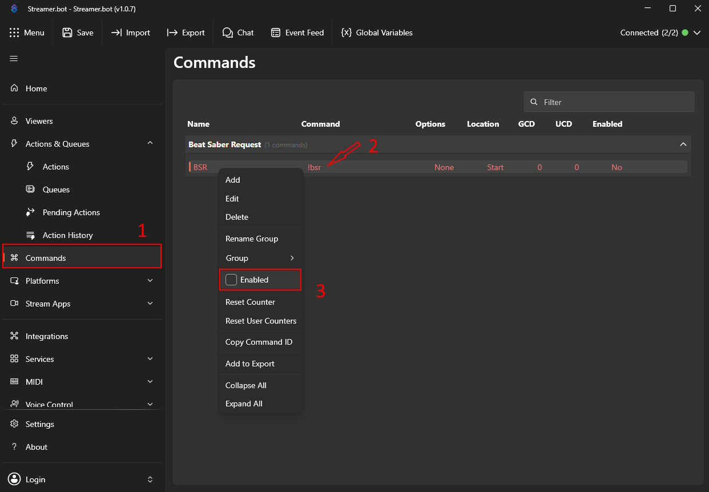

# Beat Saber Request Prioritizer

An extension to show your viewers a little love by automatically bumping their request to the top of your queue if they raid your channel and/or request a map they created.

To prioritize self-requests correctly, this extension uses [a custom mapping](https://github.com/Chantzzzzz/beat-saber-request-prioritizer/blob/main/AuthorData/authorAliases.json) to associate BeatSaver profiles to Twitch usernames in cases where these are different (or for folks who have multiple BeatSaver profiles). By default, it will try to match the requester's Twitch username to the map authors.

Some people may **unintentionally** be missing from this mapping because they're new, I don't know their Twitch username, or some other reason. If you'd like to be added, either message me on discord (same username) or feel free to open up an issue on this repository.

# !! Safety Warning !!

This extension is going to ask you to enable custom scripts regardless of your bot of choice. **Always make sure you trust the author of custom scripts before you enable them, including me!** 

I'm just making this because it seems like a cool project and I enjoy streaming Beat Saber, so I wanted to make a thing to make that a little easier, but always check your sources before installing stuff!

# Install Instructions

## Streamer.bot

See the [full instructions here](https://github.com/Chantzzzzz/beat-saber-request-prioritizer/blob/main/Streamer.bot/SETUP.md) for install and configuration options.

### Quickstart

1. Copy the contents of the [exported extension here](https://raw.githubusercontent.com/Chantzzzzz/beat-saber-request-prioritizer/refs/heads/main/Streamer.bot/beat-saber-request-prioritizer.bot.txt).
2. Open Streamerbot and click "Import" in the header bar.
3. Paste the file contents you copied in step 1 into the window that pops up, then click "Import" in the bottom right. It will warn you that it is importing custom C# code (see [this safety warning](https://github.com/Chantzzzzz/beat-saber-request-prioritizer/tree/main#-safety-warning-) for details). Click "Yes" to continue the import.
4. Streamerbot will warn you that there are commands that are disabled. Click "OK" to continue.
5. Navigate to the "Commands" tab on the left side of Streamerbot, and then find the "Beat Saber Request" command group with the `BSR` action in it. Right click on it, then click on "Enabled" to make it active. The text should turn white once enabled. See [below](#enabling-the-bsr-command) for a visual guide to performing this step.

#### Enabling the BSR Command

## Firebot

See the [full instructions here](https://github.com/Chantzzzzz/beat-saber-request-prioritizer/blob/main/Firebot/SETUP.md) for install and configuration options.

Unfortunately, since there's more manual steps a quickstart isn't really possible - you'll need to follow the full setup instructions above.

## Credits/Acknowledgements

Thank you to [Iza](https://github.com/iza-ttv) whose Streamer.bot AI Tag Checker extension I based the structure of this action from.

Thank you to [FEFELAND](https://github.com/FEFELAND) who kindly shared their dictionary mapping Twitch users to Beat Saver profile names with me.